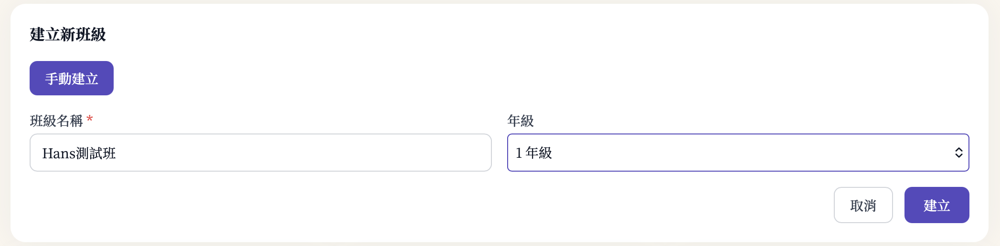
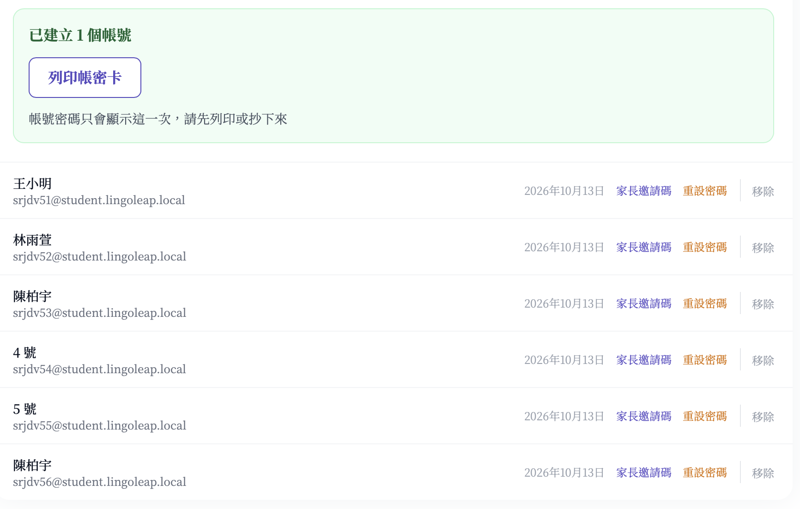
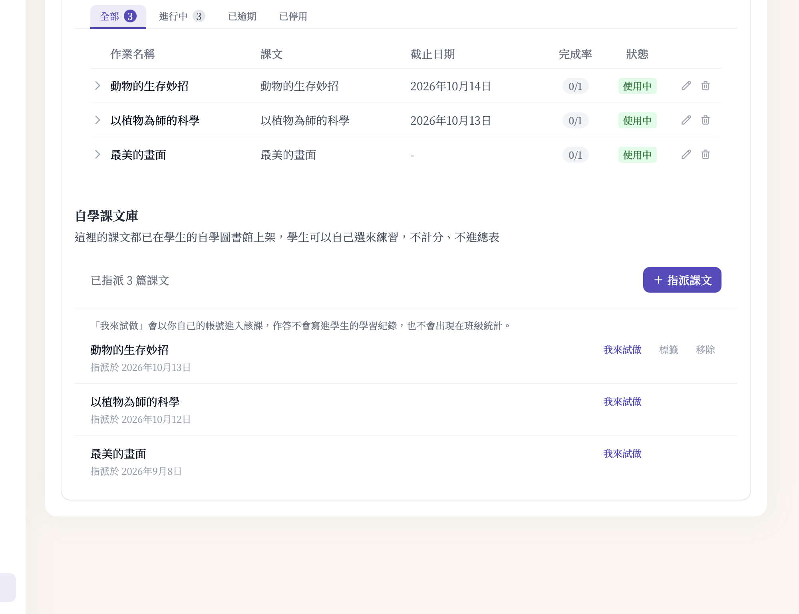
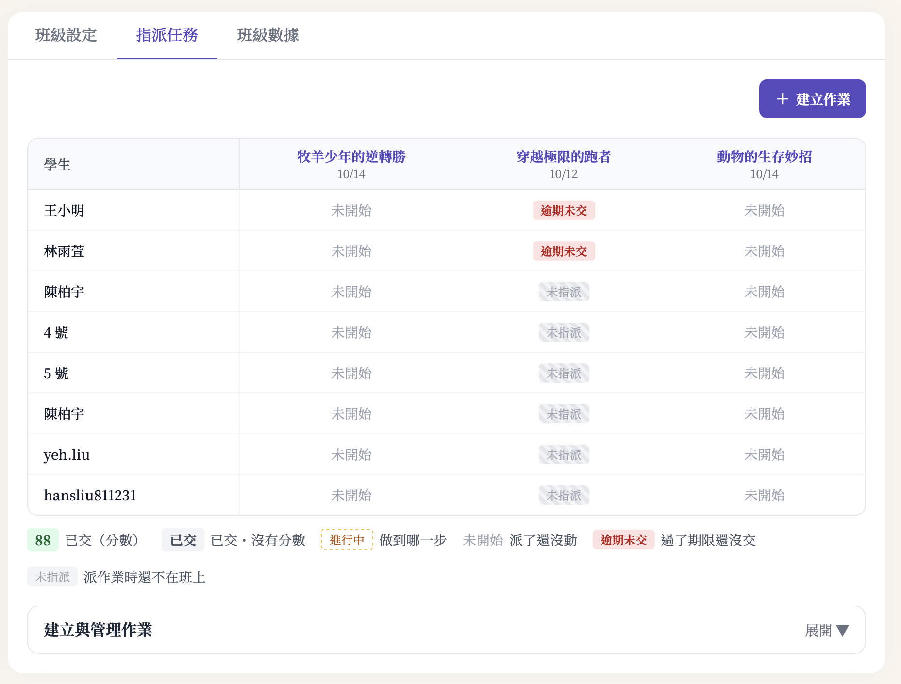

# 教師面板 · 人工驗證交辦單（第 2 版）

> 🤖 由 Claude AI 整理（非 Young 本人）· 2026-10-12 更新（對應正式站 `c15b8e78d` 的畫面）
> 交辦對象：Hans　｜　環境：**staging**（`https://lingoleap-frontend-staging-958347263320.asia-east1.run.app`）
> 每一項請打勾 ✅ 或打叉 ❌；❌ 請在最下方「發現的問題」寫下看到什麼、在哪一步，能附截圖最好。

⚠️ 請用上面這個網址，不要用 `lingoleap-staging.web.app`（那個網址前面有一層快取，偶爾會卡住舊畫面，已開 #3395 處理）。

> **驗證結果已填入（Hans，2026-10-13）**
> 環境：**production**（`lingoleap-prod.web.app`），不是交辦單上寫的 staging。
> 當日 `origin/main` 與 `origin/staging` **同一份程式碼**（領先 0 commit，教師面板檔案 md5 相同），
> 所以 A～D 結果可直接代表 staging —— **唯一例外是 A1**（匯入均一是環境變數控制，正式站刻意關閉）。
> **E～H 尚未測**。截圖在 Hans 本機，未隨此 PR 上傳（repo 為 public，截圖含真實班級名稱）。

## 0. 要驗什麼（30 秒版）

老師的班級頁照均一教育平台的樣子改版：**建班 → 加學生 → 派作業 → 看進度**，班級頁只有三個分頁：**班級設定／指派任務／班級數據**。
自動化測試已經跑過，這份是要真人照老師的用法走一遍，看順不順、看不看得懂、手機能不能用。

## 1. 怎麼登入（不需要帳號密碼）

打開上面的網址，到 `/login`，按一鍵登入按鈕 **「教師 李老師」**。
要驗學生端時（E 節），用 B 節列印出來的學生帳號登入。

⚠️ 請用**手機（或瀏覽器縮成手機寬度，約 390）**也走一次 A～D，結果記在 F 節。

---

## A. 建立班級

| # | 步驟 | 預期結果 | ✅/❌ |
|---|---|---|---|
| A1 | 進「班級管理」，按「建立班級」 | 跳出「建立新班級」，上方有「手動建立」「匯入均一班級學生」兩個選項 | — ⚠️ |
| A2 | 選「手動建立」，輸入「Hans 驗證班」，按「建立」 | **直接進到這個新班級**（不是回到班級列表），停在「班級設定」分頁 | ✅ |
| A3 | 看班級頁 | 上方三個分頁：**班級設定／指派任務／班級數據**；桌機左邊有「我的班級」清單，目前這班反白 | ✅ |
| A4 | 因為班上還沒有學生，看「班級設定」 | 直接看到「加學生：學生有沒有帳號？」 | ✅ |

## B. 加學生、帳密卡（在「班級設定」）

| # | 步驟 | 預期結果 | ✅/❌ |
|---|---|---|---|
| B1 | 選「還沒有帳號」，貼上三行：`1 王小明`、`2 林雨萱`、`3 陳柏宇` | 按鈕顯示「建立 3 個學生帳號」 | ✅ |
| B2 | 按下建立 | 綠色框「已建立 3 個帳號」，提醒「帳號密碼只會顯示這一次」；名單出現這 3 人 | ✅ |
| B3 | 按「列印帳密卡」 | 開出一頁卡片（每人一張：班級＋座號、姓名、帳號、密碼、登入網址）；**把王小明、陳柏宇的帳號密碼抄下來，E 節要用** | ✅ |
| B4 | 清空框框，只輸入 `2`，按建立 | 再建立 2 個帳號，姓名是「4 號」「5 號」 | ✅ |
| B5 | 再貼 `1 重複的人` 建立 | **只出現紅色錯誤**（座號 1 重複），沒有綠色框、沒有「列印帳密卡」 | ✅ ⚠️ |
| B6 | 切到「已經有帳號」 | 大字顯示班級代碼，說明「請學生登入（可用均一帳號）後輸入班級代碼」，下方可輸入學生編號加入 | ✅ |
| B7 | 在名單裡「4 號」那列按「重設密碼」，確認 | 跳出這位學生的**新密碼**（只顯示這一次）；把它抄下來，E4 要用 | ✅ |

## C. 派作業（在「指派任務」）

| # | 步驟 | 預期結果 | ✅/❌ |
|---|---|---|---|
| C1 | 按最上面的「**建立任務**」，選一課，「派給誰」選「全班」，期限設**明天**，按「確認建立」 | 不用重新整理，上面的作業總表**馬上多一欄**，全班 5 人都是「未開始」 | ✅ |
| C2 | 再按「建立任務」，「派給誰」選「部分學生」，**一個都不勾**就送出 | 擋下來，提示「至少勾選一位學生」 | ✅ |
| C3 | 勾王小明、林雨萱，期限設**昨天**，建立 | 總表多一欄：王小明、林雨萱是紅色「逾期未交」；其他 3 人是「未指派」 | ✅ |
| C4 | 再建立一份，勾「同時派給其他班（全班）」裡的另一班 | 兩個班都各有這份作業（用左邊「我的班級」切到另一班確認） | ✅ ⚠️ |
| C5 | 看總表下方的圖例 | 有「已交／進行中／未開始／逾期未交／未指派」，顏色跟格子一致 | ✅ ⚠️ |
| C6 | 回「班級設定」，再加一位新學生 `6 新同學`，回「指派任務」看總表 | 「新同學」在 C1（全班）是「未開始」，在 C3（部分學生）是「**未指派**」（後加入的學生不會被塞進部分學生作業） | ✅ ⚠️ |

## D. 看進度（在「班級數據」與「指派任務」）

| # | 步驟 | 預期結果 | ✅/❌ |
|---|---|---|---|
| D1 | 點「班級數據」 | 左邊（手機在上面）有：今日總覽、學生總表、早期介入、學習分析、錯字總表、詳細學習紀錄 | ✅ |
| D2 | 點「今日總覽」 | 看到「待交作業（逾期與今天到期）」「需要關注的學生」「作業進度（已交／總數）」，逾期的排最前面 | ✅ |
| D3 | 回「指派任務」，點總表裡某份作業的標題 | 看到這份作業的逐大題統計；還沒人交時會寫「還沒有學生交這份作業…」，不是空白 | ✅ |
| D4 | 在那頁點某位學生的名字 | 看到這位學生在這份作業的朗讀、理解、生字表現與「唸錯的字」（沒有資料時會明白寫出來） | ✅ |
| D5 | 「班級數據」→「學生總表」，點一位學生 | 看到他所有作業的狀態與分數；有「← 回學生名單」 | ✅ |
| D6 | 「班級數據」→「早期介入」 | 有風險的學生直接看到「風險因子」和「建議介入方式」；練習不夠的顯示「資料不足」 | ✅ |
| D7 | 用左邊「我的班級」換到另一班 | 換班後停在同一個分頁，內容換成那一班的 | ✅ |

## E. 學生端

到 `/login` 用帳號密碼登入。第一次登入會**先要求改密碼，改完才是同意使用條款**，照指示做。

| # | 步驟 | 預期結果 | ✅/❌ |
|---|---|---|---|
| E1 | 用王小明登入，看作業 | 看得到 C1（全班）和 C3（部分學生）兩份 | ⬜ 未測 |
| E2 | 用陳柏宇登入，看作業 | 只看得到 C1，**看不到 C3** | ⬜ 未測 |
| E3 | 王小明把 C1 做完交出，再回老師端看「指派任務」總表與「今日總覽」 | C1 王小明那格變「已交」；今日總覽的已交數加 1 | ⬜ 未測 |
| E4 | 用「4 號」的帳號和 B7 抄下的**新密碼**登入 | 登得進去，並且**先被要求改一組自己的密碼**；舊密碼不能再用 | ⬜ 未測 |
| E5 | 任一位新學生第一次登入 | 一定先到「改密碼」頁，改完才到使用條款，跳過不了 | ⬜ 未測 |

## F. 手機（390 寬左右）

把 A～D 用手機或縮窄的瀏覽器再走一次，只看下面幾點：

| # | 檢查 | 預期結果 | ✅/❌ |
|---|---|---|---|
| F1 | 整頁左右滑 | **整頁不會左右晃**（只有作業總表能左右滑，並有提示「← 左右滑動看更多作業 →」） | ⬜ 未測 |
| F2 | 班級頁上方 | 左邊的「我的班級」清單換成上方的「切換班級」下拉選單；三個分頁不被切掉 | ⬜ 未測 |
| F3 | 加學生、建立任務的表單 | 按鈕夠大、按得到，輸入框不超出畫面 | ⬜ 未測 |
| F4 | 「學生總表」 | 內容看得到、不破版（目前還是表格，改卡片另開 #3396，不算錯） | ⬜ 未測 |

## G. 匯入均一班級學生（只在 staging，用示範資料）

正式站這個功能是**關閉**的，只能在 staging 測。staging 讀的是**示範資料**，不是均一的真實班級。

| # | 步驟 | 預期結果 | ✅/❌ |
|---|---|---|---|
| G1 | 用李老師登入，「建立班級」→「匯入均一班級學生」 | 因為李老師沒有用均一帳號登入過，顯示「請先使用均一帳號登入過 LingoLeap，才能匯入均一班級學生」，不會出錯 | ⬜ 未測 |
| G2 | （有綁均一的老師帳號才能測，請跟 Young 要）同一個位置 | 看到示範班「四年一班（示範）（3 位）」「四年二班（示範）（2 位）」，有提示「均一今天新建的班，明天才查得到」 | ⬜ 未測 |
| G3 | 兩個都勾，按「匯入」 | 建出兩個班，人數 3 位、2 位 | ⬜ 未測 |
| G4 | 再打開一次「匯入均一班級學生」 | 兩個班都標「已匯入」，勾選框不能點（不會重複匯入） | ⬜ 未測 |

## H. 解散班級（最後做）

| # | 步驟 | 預期結果 | ✅/❌ |
|---|---|---|---|
| H1 | 「班級設定」→「解散班級」，確認 | 跳出「確定要解散『Hans 驗證班』嗎？」，確定後回到班級列表，這班不見了 | ⬜ 未測 |

## 已知、不用回報的

- 左邊「我的班級」清單會列出「已停用」的班
- 手機「學生總表」是表格不是卡片（#3396）
- 建完班級的一瞬間（約半秒）畫面還寫「尚未建立班級」，之後就進到新班級，不用回報

## 驗完之後

- A～H 的 ✅／❌ 與問題回給 Young，或直接開 issue（標題寫「教師面板人工驗證：<節次＋項次>」）
- 測試用的班級請用 H1 解散；學生帳號留著沒關係

## 發現的問題

> 截圖為 **production** 實測畫面。含真實班級名稱的部分已裁切。

---

### A1 ·「手動建立」是一顆無處可切的切換鈕

「建立新班級」只有「手動建立」一顆按鈕，沒有「匯入均一班級學生」。

**⚠️ 這在 prod 是預期行為，不算缺陷** —— G 節寫明正式站此功能關閉（環境變數控制）。

**但真正的問題是**：那顆鈕長得像分頁／切換控制項（深色實心、圓角、置於標題下方），
旁邊卻**沒有第二個選項可切**。老師會以為自己漏看了什麼。

→ **建議：正式站既然關閉，就不要顯示那顆鈕。** 這一項仍需在 staging 補驗。

---

### B5 · 座號重複會擋，**姓名重複不會**

座號重複**有**被擋（符合 B5 預期 ✅）。

但再建一次「陳柏宇」會**成功** —— 綠色框「已建立 1 個帳號」照跳、「列印帳密卡」照出，
名單出現**兩個陳柏宇**（`srjdv53` 與 `srjdv56`）。

規格只要求擋座號，所以**不算違規**。但同班兩個同名學生，
老師在作業總表上（只顯示姓名）**分不出誰是誰**。

---

### C4 · 解除之後，作業沒有從列表消失

跨班指派本身正常 ✅（另一班確實也有這份作業）。

但測試班級把作業解除之後，**「以植物為師的科學」（截止 10/13）仍留在列表，狀態還是「使用中」**。

---

### C5 / C6 · 圖例那句話是錯的

功能正常 ✅，但圖例寫著：

> **未指派**　派作業時還不在班上

**這個說明不成立。** 截圖裡 `hansliu811231` 正是**派作業之後**才加入班級的學生 ——
他在兩份「全班」作業（牧羊少年 10/14、動物的生存妙招 10/14）上顯示的是「**未開始**」，
只有「部分學生」那一份（穿越極限的跑者 10/12）才是「未指派」。

**真正的語意是**：「這份作業沒有被指派給這位學生」—— 因為老師用的是「指派給部分學生」，
**跟他什麼時候加入班級無關**。全班指派的作業，後加入的學生照樣會收到。

→ 建議把圖例改成「**這份作業沒有指派給他**」之類的說法。

---

### 補充（通過但值得記的行為）

- **B3** 列印帳密卡會**跳新分頁**開啟
- **B4** 只輸入 `2` 會新增兩位，姓名自動帶「4 號」「5 號」，符合預期
- **B6** 以 `yeh.liu` 帳號透過班級代碼加入成功

---

第 1 版（2026-10-11，五個分頁的舊畫面）的 AI 代測結果，見這個檔案在 commit `c41fab04f` 的版本。
